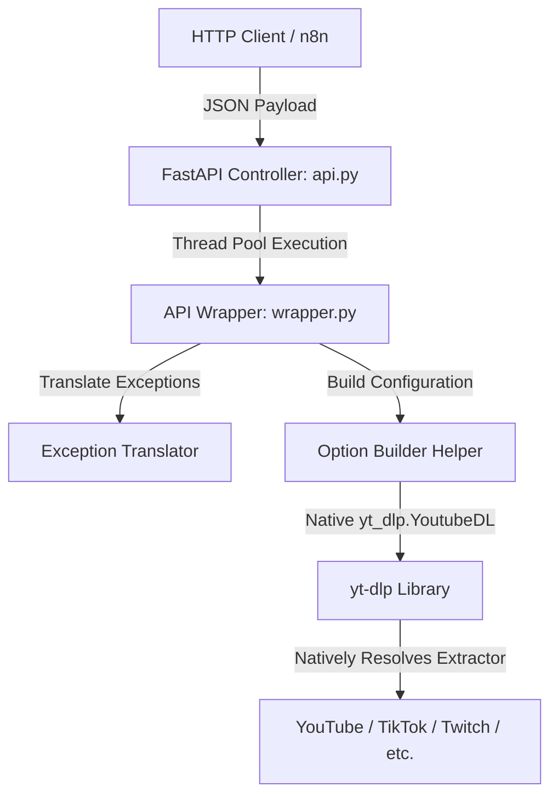

# yt-dlp API Wrapper

A high-performance, platform-agnostic, and clean-architecture FastAPI wrapper around the native [`yt-dlp`](https://github.com/yt-dlp/yt-dlp) Python library.

This API operates completely in-process by utilizing native Python bindings. It avoids calling the `yt-dlp` CLI via subprocesses, avoiding command-line execution overhead and making it perfect for cloud hosting, containerized setups, and automation pipelines (like **n8n**).

---

## Features

*   **100% Subprocess-Free**: Interacts directly with native `yt-dlp` classes and methods.
*   **Thread Safe**: Blocking execution routes are handled on FastAPI's background thread pool, preventing CPU-bound tasks from blocking the async event loop.
*   **Configuration-Driven**: Extensively configurable via structured JSON payloads. Supports customizing audio/video parameters, subtitles, chapters, auth credentials, SponsorBlock integration, proxies, cookies, and download archives.
*   **Raw Execution Hub (`/run`)**: A generic endpoint that accepts arbitrary raw dictionaries mapping directly to native `yt-dlp` options. This guarantees compatibility with future `yt-dlp` updates without requiring API code modifications.
*   **Enterprise-Ready Error Handling**: Translates native extractor, network, or downloader exceptions into structured HTTP status codes (`400`, `404`, `502`, `500`).
*   **n8n-Compatible**: Designed for immediate ingestion by n8n HTTP Request nodes without complex pre-processing.

---

## Architecture Design



---

## Installation & Requirements

### System Requirements
*   Python 3.9 or higher.
*   **FFmpeg** installed and added to the system `PATH` (required for merging audio/video tracks and converting formats).

### Dependency Setup

1.  Clone the repository and navigate to the project directory:
    ```bash
    cd yt-dlp-api
    ```
2.  Install required dependencies:
    ```bash
    pip install -r requirements.txt
    ```

---

## Running Locally

To start the development server with hot-reloading:

```bash
uvicorn api:app --reload
```

The server will bind to `http://127.0.0.1:8000`.
*   **Interactive Swagger Documentation**: [`http://127.0.0.1:8000/docs`](http://127.0.0.1:8000/docs)
*   **ReDoc Alternative Documentation**: [`http://127.0.0.1:8000/redoc`](http://127.0.0.1:8000/redoc)

---

## Running on Ubuntu (Systemd Service Production Guide)

To deploy the API wrapper as a production service on Ubuntu, use **Systemd** alongside **Gunicorn/Uvicorn**:

### 1. Install Production Dependencies
Ensure you install FFmpeg and virtual environment utilities:
```bash
sudo apt update
sudo apt install -y ffmpeg python3-pip python3-venv
```

### 2. Configure Virtual Environment
```bash
python3 -m venv venv
source venv/bin/activate
pip install -r requirements.txt gunicorn
```

### 3. Create Systemd Service File
Create a new service configuration:
```bash
sudo nano /etc/systemd/system/ytdlp-api.service
```

Paste the following configurations (adjusting directories and users as needed):
```ini
[Unit]
Description=FastAPI yt-dlp API Wrapper
After=network.target

[Service]
User=ubuntu
WorkingDirectory=/home/ubuntu/yt-dlp-api
ExecStart=/home/ubuntu/yt-dlp-api/venv/bin/gunicorn api:app -w 4 -k uvicorn.workers.UvicornWorker -b 0.0.0.0:8000
Restart=always

[Install]
WantedBy=multi-user.target
```

### 4. Enable and Start the Service
```bash
sudo systemctl daemon-reload
sudo systemctl start ytdlp-api
sudo systemctl enable ytdlp-api
```

Check service status to verify running states:
```bash
sudo systemctl status ytdlp-api
```

---

## API Endpoint Reference

### 1. `GET /health`
Verifies service availability.
*   **Response (`200 OK`)**:
    ```json
    {
      "status": "ok"
    }
    ```

### 2. `POST /metadata`
Extracts full metadata without downloading files.
*   **Payload**:
    ```json
    {
      "url": "https://www.youtube.com/watch?v=aqz-KE-bpKQ",
      "extract_flat": false
    }
    ```
*   **Response (`200 OK`)**: Returns a dictionary wrapping the raw sanitized metadata dictionary.

### 3. `POST /formats`
Lists all available streaming formats.
*   **Payload**:
    ```json
    {
      "url": "https://www.youtube.com/watch?v=aqz-KE-bpKQ"
    }
    ```
*   **Response (`200 OK`)**: A list of objects containing codecs, bitrates, URLs, resolutions, and extensions.

### 4. `POST /download`
Downloads the target video or playlist using structured configuration parameters.
*   **Payload**:
    ```json
    {
      "url": "https://www.youtube.com/watch?v=aqz-KE-bpKQ",
      "options": {
        "audio_only": true,
        "preferred_codec": "mp3",
        "audio_bitrate": "320",
        "output_template": "/downloads/%(title)s.%(ext)s"
      }
    }
    ```
*   **Response (`200 OK`)**: Returns confirmation and the downloaded media metadata.

### 5. `POST /run`
A raw pass-through interface designed for ultimate flexibility. Accepts any options dictionary directly mapped to native `yt-dlp` constructor options.
*   **Payload**:
    ```json
    {
      "url": "https://www.youtube.com/watch?v=aqz-KE-bpKQ",
      "options": {
        "skip_download": true,
        "playlist_items": "1-3",
        "writethumbnail": true
      }
    }
    ```
*   **Response (`200 OK`)**: Returns the native result dictionary.

---

## Client Integration Examples

### Curl Requests

#### Metadata Extraction
```bash
curl -X POST "http://127.0.0.1:8000/metadata" \
     -H "Content-Type: application/json" \
     -d '{"url": "https://www.youtube.com/watch?v=aqz-KE-bpKQ"}'
```

#### Audio-Only Download Configuration
```bash
curl -X POST "http://127.0.0.1:8000/download" \
     -H "Content-Type: application/json" \
     -d '{
       "url": "https://www.youtube.com/watch?v=aqz-KE-bpKQ",
       "options": {
         "audio_only": true,
         "preferred_codec": "mp3",
         "audio_bitrate": "256"
       }
     }'
```

---

### Python Script Integration

```python
import requests

url = "http://127.0.0.1:8000/download"
payload = {
    "url": "https://www.youtube.com/watch?v=aqz-KE-bpKQ",
    "options": {
        "resolution": "1080",
        "merge_output_format": "mp4",
        "skip_existing": True
    }
}

response = requests.post(url, json=payload)
if response.status_code == 200:
    print("Download completed successfully!")
    print("Video Title:", response.json()["info"]["title"])
else:
    print(f"Error {response.status_code}:", response.json()["detail"])
```

---

### n8n Workflow Integration (HTTP Request Node)

To consume this API wrapper in **n8n**, configure the **HTTP Request Node** as follows:

```
Method: POST
URL: http://<your-server-ip>:8000/run
Send Body: Yes
Body Content Type: JSON
JSON Parameters: Yes
```

#### n8n Query Parameter Payload Template
```json
{
  "url": "={{ $node[\"Trigger\"].json[\"url\"] }}",
  "options": {
    "skip_download": true,
    "playlist_items": "1"
  }
}
```

This captures the URL dynamically from an upstream trigger and utilizes the pass-through configuration to safely extract metadata.

---

## Common Troubleshooting

### 1. `ExtractorError` / "Unsupported URL"
*   **Cause**: The URL belongs to a streaming service not supported by `yt-dlp`, or `yt-dlp` requires an update to match upstream changes.
*   **Solution**: Upgrade `yt-dlp` in your active python environment:
    ```bash
    pip install --upgrade yt-dlp
    ```

### 2. FFmpeg Extraction/Conversion Errors
*   **Cause**: FFmpeg is not installed or not in the environment PATH.
*   **Solution**: Download FFmpeg and verify accessibility by executing `ffmpeg -version` in your terminal. On Ubuntu, execute `sudo apt install ffmpeg`.

### 3. Service Blocking / High CPU Load
*   **Cause**: Heavy format downloads or encoding processes blocks the server thread.
*   **Solution**: Our endpoints use standard sync `def` routing handlers. FastAPI automatically delegates these calls to a background thread pool, meaning concurrent downloads will not choke the application server. For high-volume production, configure Gunicorn workers as documented in the Ubuntu Service setup guide.
